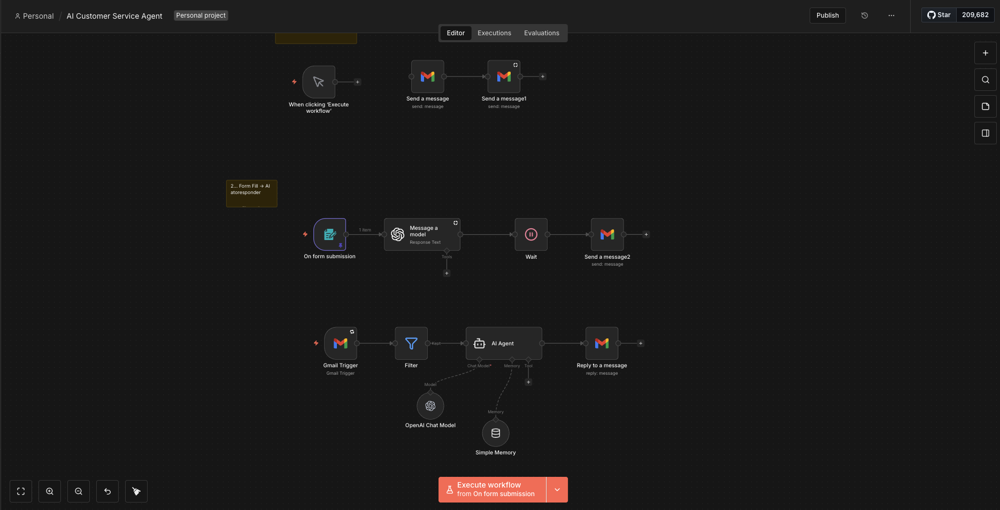
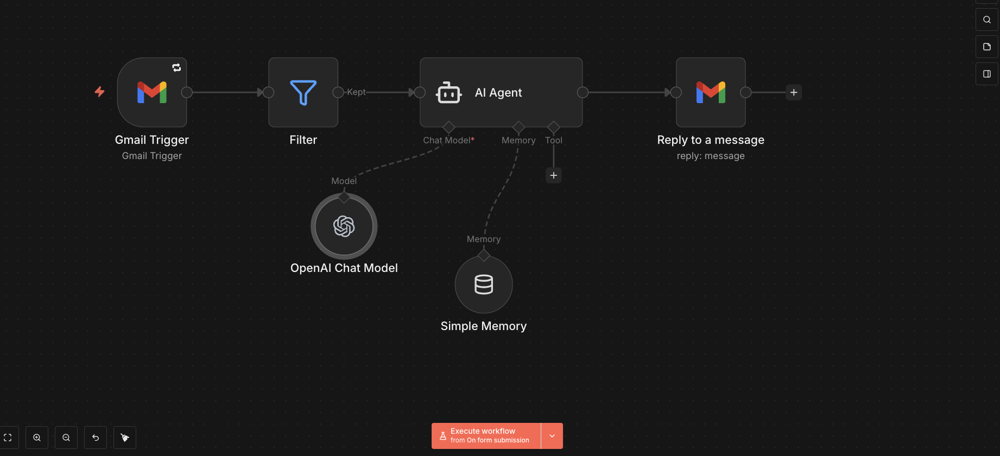
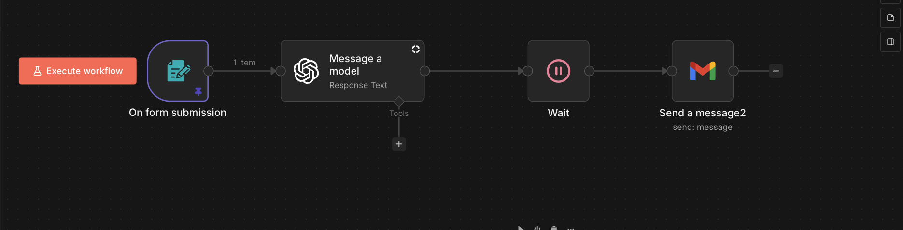

# AI Customer Service Agent

### AI-Powered Customer Onboarding and Email Automation Using n8n and OpenAI

## Project Overview

This project demonstrates an AI-powered customer onboarding and email automation system developed using **n8n, OpenAI and Gmail**.

The workflow is designed to collect customer information through an onboarding form, generate personalised emails using Generative AI, and automate responses to incoming customer enquiries.

It demonstrates how AI can be integrated into business processes to improve communication efficiency, reduce repetitive administrative tasks and support customer engagement.

## Technologies Used

- **n8n:** Workflow automation and orchestration
- **OpenAI GPT-4.1:** Personalised onboarding email generation
- **OpenAI GPT-4.1 mini:** AI-powered email response generation
- **Gmail:** Automated email delivery and incoming message monitoring
- **Conversation Memory:** Maintaining context across email interactions
- **JSON:** Workflow configuration

## Key Features

### 1. Automated Customer Onboarding

- Collects customer information through a structured onboarding form.
- Uses OpenAI to generate personalised onboarding emails based on submitted information.
- Connects AI-generated content to Gmail for automated email delivery.

### 2. AI-Powered Email Responses

- Monitors incoming emails using a Gmail trigger.
- Uses an AI Agent to generate context-aware responses to customer enquiries.
- Integrates OpenAI models to support automated email communication.

### 3. Workflow Orchestration

- Connects form submissions, AI models, Gmail actions and filtering logic.
- Uses interconnected n8n nodes to coordinate the automation process.
- Demonstrates the integration of AI tools with existing business applications.

### 4. Conversation Context

- Uses conversation memory associated with Gmail thread IDs.
- Designed to support consistent and relevant responses across customer interactions.

## Workflow Screenshots

### Complete Workflow Overview

### AI Agent and Conversation Memory

### Customer Onboarding Automation

## Project Purpose

The aim of this project is to explore how Generative AI and workflow automation can support customer-facing business operations.

It demonstrates practical experience in:

- AI workflow design and implementation
- Business process automation
- Integration of AI models with third-party applications
- Customer onboarding automation
- Workflow testing and refinement

## Implementation

The automation was developed using n8n's visual workflow editor, integrating OpenAI models, Gmail services, form triggers and conversation memory.

The complete workflow configuration is not publicly distributed. This repository provides project documentation and screenshots to demonstrate the system's architecture and functionality.

## Project Type

**Personal AI Automation Project | 2026**
